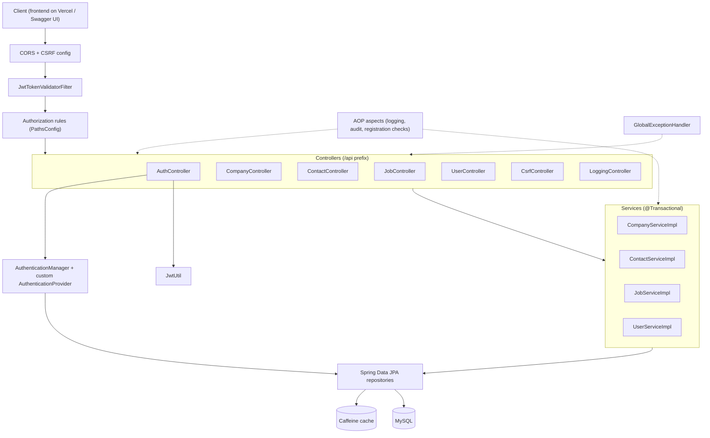
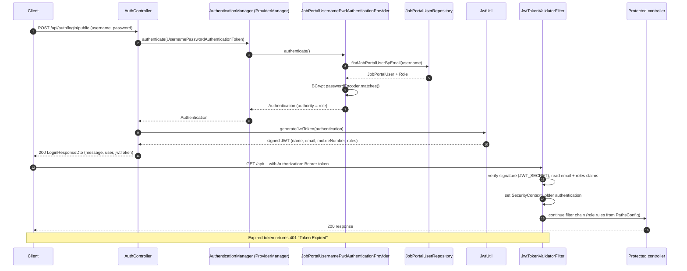
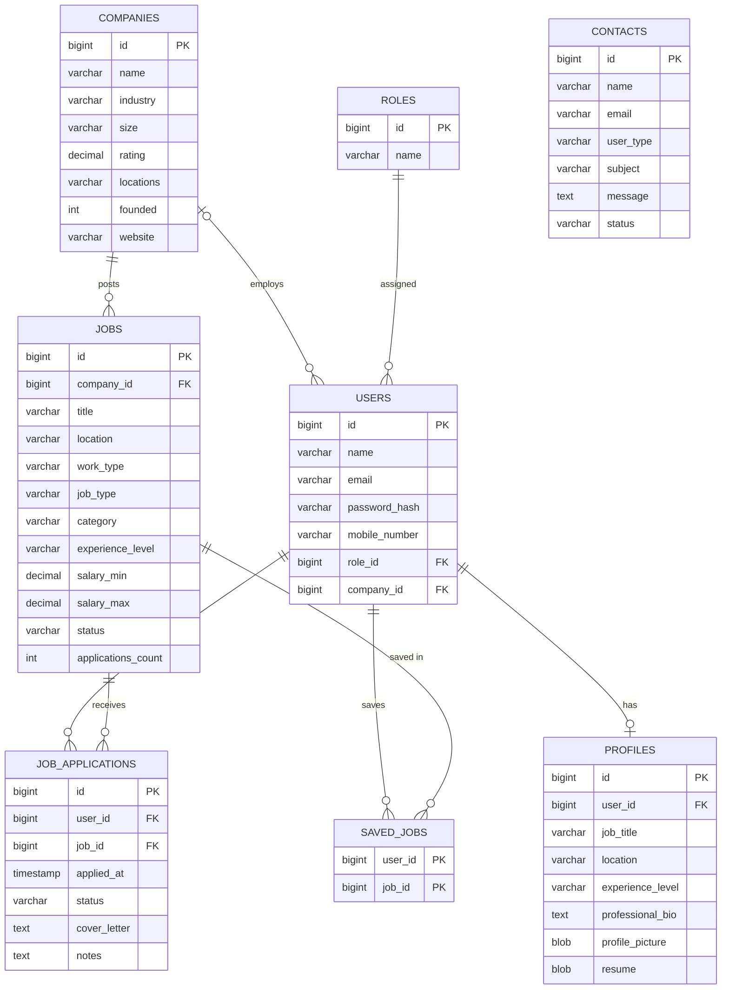

# Job Portal REST API

REST backend for a job portal with job seeker, employer, and admin roles, built with Spring Boot 4, Java 21, Spring Security (JWT), Spring Data JPA, and MySQL. It exposes 32 endpoints across 7 controllers and is deployed on Render behind a Vercel frontend.


## Live links

- Live demo: https://sk-jobportal.vercel.app

## Features

### Authentication & Security
- Stateless JWT authentication: `JwtUtil` issues an HMAC-signed token on login (24h by default, 1h in the `prod` profile) and `JwtTokenValidatorFilter` validates the `Authorization: Bearer` header on every non-public request.
- Custom `AuthenticationProvider`s selected by profile: `JobPortalUsernamePwdAuthenticationProvider` (`prod`, verifies the BCrypt hash) and `JobPortalNonProdUsernamePwdAuthenticationProvider` (non-prod, skips the password check to simplify local testing).
- Passwords hashed with `BCryptPasswordEncoder`.
- Breached-password check on registration using Spring Security's `HaveIBeenPwnedRestApiPasswordChecker` (HaveIBeenPwned range API, k-anonymity: only a SHA-1 prefix leaves the server).
- Three roles: `ROLE_JOB_SEEKER`, `ROLE_EMPLOYER`, `ROLE_ADMIN`. URL-based access rules are defined in `PathsConfig`; anything not listed is denied.
- Configurable CORS (`app.cors.*`) and CSRF (cookie-based token, disabled in `prod` where auth is header-based JWT).

### Jobs & Applications
- Public company and active-job listing.
- Employers create jobs (saved as `DRAFT`), change job status (`ACTIVE` / `CLOSED` / `DRAFT`), view applicants, and move applications through `PENDING`, `IN_REVIEW`, `INTERVIEW`, `HIRED`, `REJECTED`.
- Job seekers maintain a profile with profile-picture and resume upload (multipart, stored as BLOBs), save/unsave jobs, apply with a cover letter, and withdraw applications.
- Admins manage companies, read and close contact messages (sorting and pagination), search users, promote a user to employer, and assign an employer to a company.
- API versioning through a media type parameter (`application/vnd.eazyapp+json;v=1.0`, default `1.0`), configured in `WebConfig`. All controller routes are prefixed with `/api`.

### Data & Transactions
- Spring Data JPA with derived queries, JPQL/native named queries, `@Modifying` bulk updates, and `Pageable`/`Sort` support.
- Lazy `@ManyToOne` / `@OneToOne` associations on `Job`, `JobApplication`, and `Profile`; `CascadeType.ALL` with `orphanRemoval` on `Company.jobs`; database-level `@OnDelete` cascade / set-null rules.
- N+1 mitigation with `JOIN FETCH`, `@BatchSize`, and `hibernate.default_batch_fetch_size`.
- Services are `@Transactional(readOnly = true)` at class level, with write methods overriding to read-write. Multi-table writes such as applying for a job (insert application + increment the job's application count) run in a single transaction.
- JPA auditing (`created_at/by`, `updated_at/by`) through `AuditorAwareImpl`, which records the logged-in user.
- Caffeine caching (`@EnableCaching`) with per-cache TTL and size set per profile: `jobs` (public company/job listing), `companies` (admin listing, evicted on create/update/delete), and `roles`.

### Observability
- SLF4J logging (Lombok `@Slf4j`) with Logback: colored console output, plus a rolling file appender in the default and `qa` profiles that writes one JSON-style line per event (timestamp, level, logger, message) and rolls by size and day (1 MB files, 30 days history, 1 GB cap). The `prod` profile logs to the console only so the hosting platform captures it.
- Spring AOP aspects: method entry/exit and execution-time logging (`LoggingAndPerformanceAspect`), exception auditing (`ExceptionAuditAspect`), successful-login auditing (`LoginSuccessAuditAspect`), and pre-registration validation (`RegisterValidationAspect`).
- Centralized error handling in `GlobalExceptionHandler` (`@RestControllerAdvice`) for validation errors, registration errors, and unexpected exceptions.

### API Docs
- springdoc-openapi (`springdoc-openapi-starter-webmvc-ui`) generates the OpenAPI spec from the controllers; Swagger UI paths are whitelisted in `PathsConfig`.
- 32 endpoints across 7 controllers (see [API overview](#api-overview)).
- Jakarta Bean Validation on request DTOs (`@NotBlank`, `@Email`, `@Size`, `@Pattern`, `@NotNull`) enforced with `@Valid` on the contact, company, job, and job-application endpoints.

## Tech stack

| Area | Technology |
|------|------------|
| Language | Java 21 |
| Framework | Spring Boot 4.0.0 (Spring Web MVC, Spring Security, Spring Data JPA, Validation, Cache, AOP) |
| Database | MySQL (`mysql-connector-j`), Hibernate ORM |
| Auth | JWT (jjwt 0.13.0), BCrypt, HaveIBeenPwned password checker |
| Caching | Caffeine |
| API docs | springdoc-openapi 2.8.14 |
| Logging | SLF4J, Logback |
| Build | Maven (wrapper included), Lombok |
| Containers | Dockerfile (multi-stage, Temurin 21), Docker Compose (MySQL), `spring-boot-docker-compose` |

## Architecture



## Authentication flow



## Data model



All tables also carry audit columns (`created_at`, `created_by`, `updated_at`, `updated_by`) from `BaseEntity`. The full DDL is in `src/main/resources/sql/jobportal-schema.sql`.

## API overview

All paths are prefixed with `/api`, and each path ends with its audience: `/public`, `/admin`, `/employer`, or `/jobseeker`. Public endpoints need no token; all others require `Authorization: Bearer <jwt>`.

| Method | Path | Audience | Purpose |
|--------|------|--------|---------|
| POST | `/api/auth/register/public` | Public | Register a job seeker (breached-password and duplicate email/mobile checks) |
| POST | `/api/auth/login/public` | Public | Log in and receive a JWT |
| GET | `/api/csrf-token/public` | Public | Fetch the CSRF token (when CSRF is enabled) |
| GET | `/api/logging/public` | Public | Emit sample log lines at each level |
| GET | `/api/companies/public` | Public | Companies with their active jobs (cached) |
| POST | `/api/contacts/public` | Public | Submit a contact message |
| GET | `/api/companies/admin` | ADMIN | List all companies (cached) |
| POST | `/api/companies/admin` | ADMIN | Create a company |
| PUT | `/api/companies/{id}/admin` | ADMIN | Update a company |
| DELETE | `/api/companies/{id}/admin` | ADMIN | Delete a company |
| GET | `/api/contacts/admin` | ADMIN | New contact messages |
| GET | `/api/contacts/sort/admin` | ADMIN | New contact messages, sorted (`sortBy`, `sortDir`) |
| GET | `/api/contacts/page/admin` | ADMIN | New contact messages, paginated and sorted |
| PATCH | `/api/contacts/{id}/status/admin` | ADMIN | Close a contact message |
| GET | `/api/users/search/admin?email=` | ADMIN | Find a user by email |
| PATCH | `/api/users/{userId}/role/employer/admin` | ADMIN | Promote a user to employer |
| PATCH | `/api/users/{userId}/company/{companyId}/admin` | ADMIN | Assign an employer to a company |
| GET | `/api/jobs/employer` | EMPLOYER | Jobs of the employer's company |
| POST | `/api/jobs/employer` | EMPLOYER | Create a job (status `DRAFT`) |
| PATCH | `/api/jobs/{jobId}/status/employer` | EMPLOYER | Change job status |
| GET | `/api/jobs/applications/{jobId}/employer` | EMPLOYER | Applications for a job |
| PATCH | `/api/jobs/applications/employer` | EMPLOYER | Update application status and notes |
| GET | `/api/users/profile/jobseeker` | JOB_SEEKER | Get own profile |
| PUT | `/api/users/profile/jobseeker` | JOB_SEEKER | Create/update profile (multipart: `profile`, `profilePicture`, `resume`) |
| GET | `/api/users/profile/picture/jobseeker` | JOB_SEEKER | Download profile picture |
| GET | `/api/users/profile/resume/jobseeker` | JOB_SEEKER | Download resume |
| GET | `/api/users/saved-jobs/jobseeker` | JOB_SEEKER | List saved jobs |
| POST | `/api/users/saved-jobs/{jobId}/jobseeker` | JOB_SEEKER | Save a job |
| DELETE | `/api/users/saved-jobs/{jobId}/jobseeker` | JOB_SEEKER | Unsave a job |
| GET | `/api/users/job-applications/jobseeker` | JOB_SEEKER | List own applications |
| POST | `/api/users/job-applications/jobseeker` | JOB_SEEKER | Apply for a job |
| DELETE | `/api/users/job-applications/{jobId}/jobseeker` | JOB_SEEKER | Withdraw an application |

## Getting started

### Prerequisites
- JDK 21
- Docker (for the local MySQL container)
- Maven is optional; the Maven wrapper (`mvnw` / `mvnw.cmd`) is included

### Environment variables

All have local defaults, so none are required for a quick local run. Set them for any shared or hosted environment.

| Variable | Used for |
|----------|----------|
| `SPRING_PROFILES_ACTIVE` | `prod` or `qa` (default profile when unset) |
| `JWT_SECRET` | HMAC key for signing JWTs (at least 32 characters). Always set this outside local development. |
| `DATABASE_URL` | Full JDBC URL (`prod` profile) |
| `DATABASE_HOST`, `DATABASE_PORT`, `DATABASE_NAME` | DB location when `DATABASE_URL` is not set |
| `DATABASE_USERNAME`, `DATABASE_PASSWORD` | DB credentials |
| `PORT` | HTTP port (`prod` profile) |
| `CORS_ALLOWED_ORIGINS` | Allowed frontend origin(s) (`prod` profile) |
| `DDL_AUTO` | Hibernate `ddl-auto` (`prod` profile, default `update`) |
| `DB_POOL_SIZE` | Hikari max pool size (`prod` profile) |
| `SHOW_SQL`, `HIBERNATE_FORMAT_SQL`, `DEFAULT_BATCH_FETCH_SIZE` | JPA/Hibernate tuning |
| `LOG_LEVEL`, `LOG_LEVEL_ERROR`, `LOG_PATH`, `CONSOLE_LOG_PATTERN` | Logging |

### Run locally

```bash
git clone https://github.com/Dopatisukumar/jobportal-backend.git
cd jobportal-backend

# Start MySQL (compose.yml defines a single MySQL service named jobportaldb)
docker compose up -d

# Create tables and load sample data (default profile does not auto-create the schema)
docker exec -i jobportaldb mysql -uroot -proot jobportal < src/main/resources/sql/jobportal-schema.sql
docker exec -i jobportaldb mysql -uroot -proot jobportal < src/main/resources/sql/jobportal-data.sql

# Run the app (on Windows: .\mvnw.cmd spring-boot:run)
./mvnw spring-boot:run
```

`spring-boot-docker-compose` is on the classpath, so `./mvnw spring-boot:run` also starts the MySQL container from `compose.yml` automatically if it is not already running.

- API base URL: `http://localhost:8080/api`

Registration always creates a `ROLE_JOB_SEEKER` user. To try the admin endpoints, change that user's `role_id` to the `ROLE_ADMIN` row in the `roles` table.

### Run with Docker

The `Dockerfile` is a multi-stage build (Maven + Temurin 21 JRE):

```bash
docker build -t jobportal-backend .
docker run -p 8080:8080 \
  -e SPRING_PROFILES_ACTIVE=prod \
  -e DATABASE_URL="jdbc:mysql://<host>:3306/jobportal" \
  -e DATABASE_USERNAME=<user> -e DATABASE_PASSWORD=<password> \
  -e JWT_SECRET=<32+ char secret> \
  -e CORS_ALLOWED_ORIGINS=http://localhost:5173 \
  jobportal-backend
```

## Project structure

```
src/main/java/com/eazybytes/jobportal
├── JobportalApplication.java   # @EnableCaching, @EnableJpaAuditing
├── aspects/                    # AOP: logging/performance, exception audit, login audit, registration validation
├── audit/                      # AuditorAwareImpl for JPA auditing
├── auth/                       # AuthController (login, register)
├── cache/                      # CaffeineCacheConfig
├── company/                    # CompanyController, LoggingController, company service
├── config/web/                 # WebConfig (/api prefix, API versioning)
├── constants/                  # ApplicationConstants
├── contact/                    # ContactController, contact service
├── dto/                        # Request/response records and enums
├── entity/                     # JPA entities + BaseEntity (audit columns)
├── exception/                  # GlobalExceptionHandler, RegistrationValidationException
├── job/                        # JobController, job service
├── repository/                 # Spring Data JPA repositories
├── security/                   # Security config, auth providers, PathsConfig, JWT filter, CORS props
├── user/                       # UserController, user service
└── util/                       # ApplicationUtility (mapping, logged-in user)
src/main/resources
├── application.properties, application-qa.properties, application-prod.properties
├── jwt.properties, logback.xml
└── sql/                        # schema and sample data
```

## Roadmap

- Notification service consuming RabbitMQ events (`ApplicationSubmitted`) with retries and a dead-letter queue.
- JUnit 5 / Mockito unit tests for services and `@WebMvcTest` slice tests for controllers (currently only a context-load test).
- Upgrade springdoc-openapi to 3.x for Spring Boot 4 support.
- API gateway in front of the backend and future services.

## Author

Sukumar Dopati
- LinkedIn: https://linkedin.com/in/dopati-sukumar
- GitHub: https://github.com/Dopatisukumar
